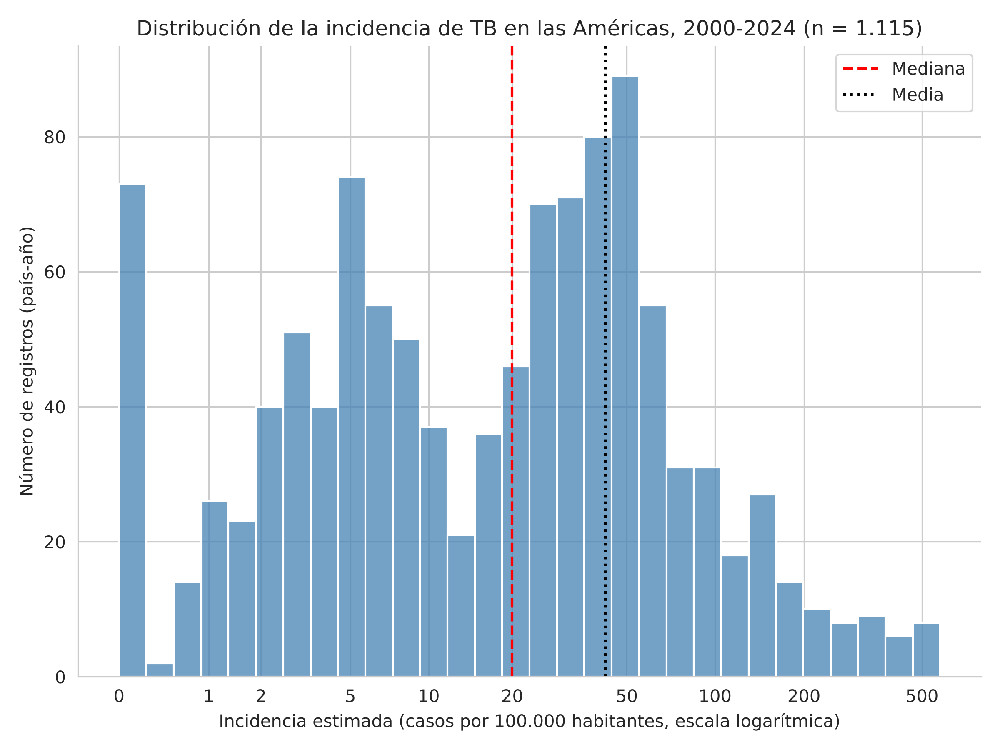
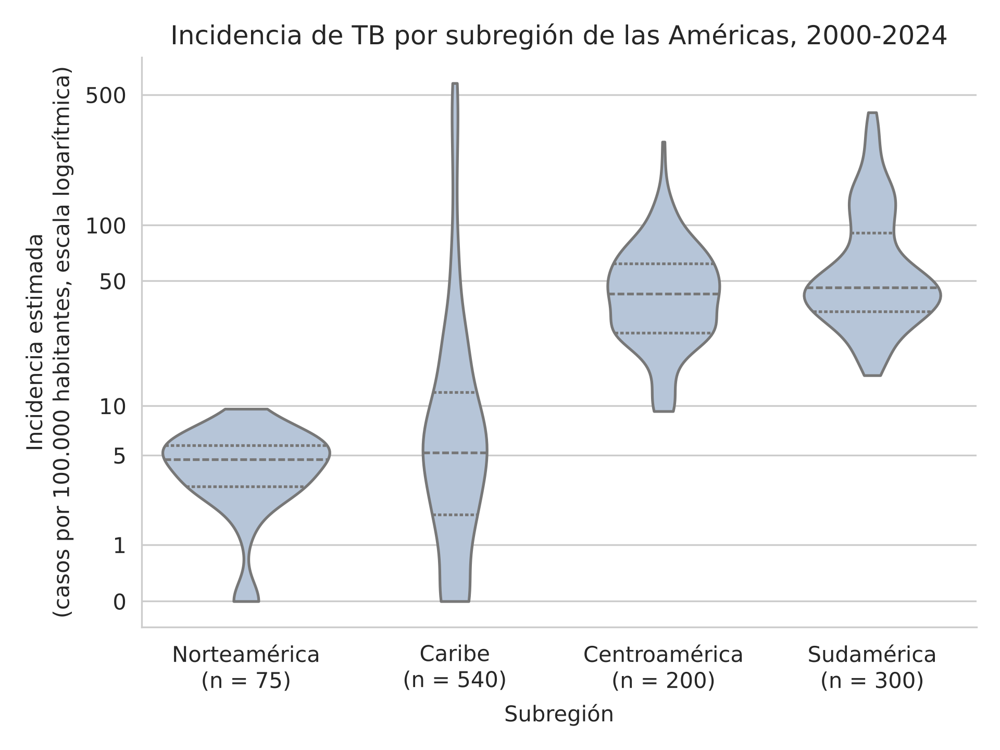
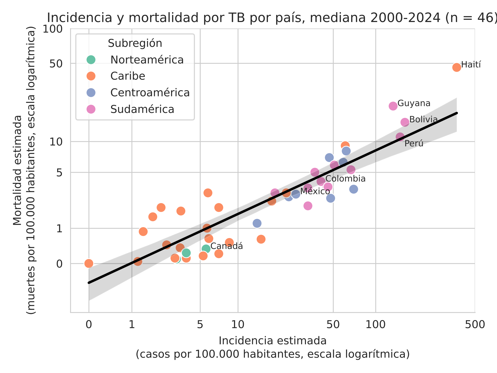
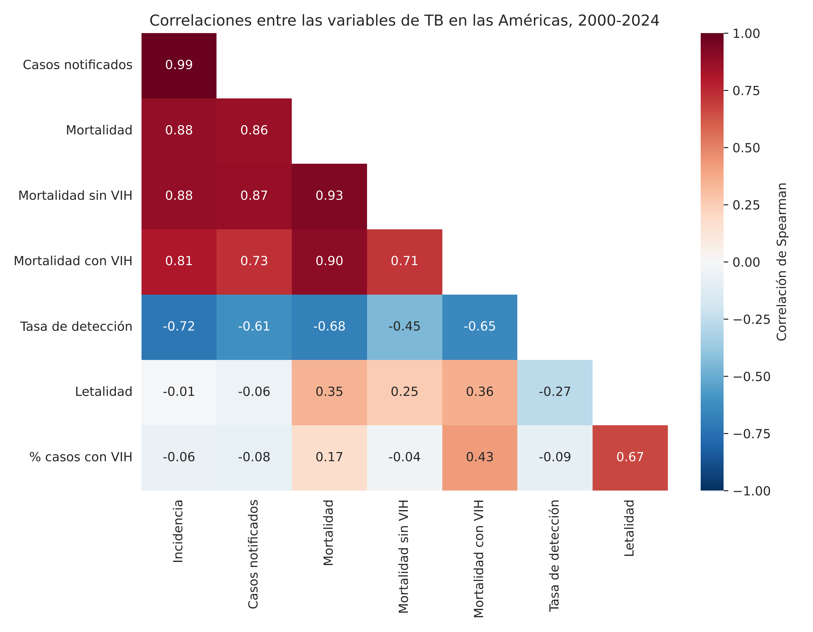
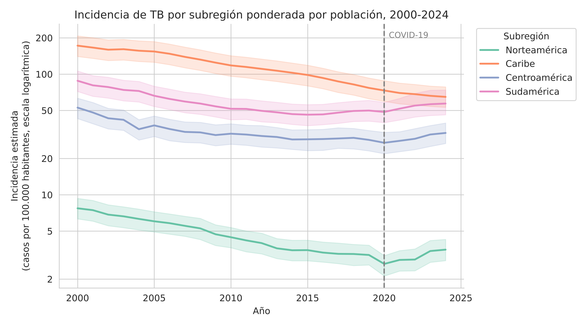
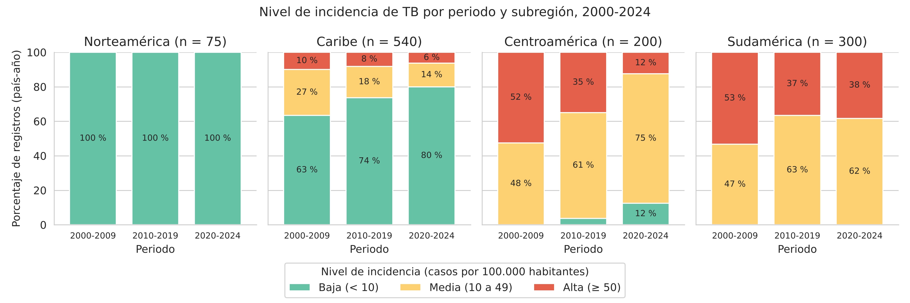

# Carga de tuberculosis en la región de las Américas 2000-2024: análisis exploratorio

Análisis exploratorio de datos realizado con Python.

## El conjunto de datos

- **Fuente:** *WHO TB burden estimates*, Programa Mundial de Tuberculosis de la Organización Mundial de la Salud (OMS). Descargado el 12 de noviembre de 2026 desde <https://www.who.int/teams/global-tuberculosis-programme/data> (en la pestaña *CSV files*).
- **Licencia:** el uso de los datos está sujeto a la [política de datos](https://www.who.int/about/policies/publishing/data-policy) y a los términos y condiciones de la OMS.
- **Contenido:** estimaciones de incidencia, mortalidad (con y sin VIH), letalidad y tasa de detección de casos, con sus intervalos de incertidumbre, para cada país y año.
- **Tamaño:** el archivo original tiene 5.347 registros y 50 columnas (217 países y territorios). Se filtró la región de las Américas: **1.115 registros de 46 países y territorios**. Tras la limpieza quedaron 17 columnas, más 3 variables derivadas (subregión, periodo y nivel de incidencia).

## Preguntas

1. ¿Cómo se distribuye la carga de tuberculosis entre las subregiones de las Américas y qué países concentran los valores más altos?
2. ¿Los países con más casos de tuberculosis también tienen más muertes, y de qué depende la proporción de personas que mueren?
3. ¿Cómo ha cambiado la incidencia de tuberculosis entre 2000 y 2024?

## Figuras principales

**Figura 1. Distribución de la incidencia.** La incidencia forma dos grupos (alrededor de 5 y de 30 a 50 casos por 100.000 habitantes); los 96 valores atípicos se concentran en Haití, Perú, Bolivia y Guyana.



**Figura 2. Incidencia por subregión.** Norteamérica y el Caribe tienen medianas cercanas a 5 casos por 100.000 habitantes, frente a más de 40 en Centroamérica y Sudamérica; la cola del Caribe corresponde a Haití.



**Figura 3. Incidencia y mortalidad por país.** Los países con más casos tienen más muertes (correlación de Spearman = 0,89); Guyana queda por encima de lo esperado.



**Figura 4. Correlaciones.** La letalidad no se relaciona con la incidencia (−0,01), pero sí con el porcentaje de casos con VIH (0,67).



**Figura 5. Evolución de la incidencia ponderada por población.** La incidencia bajó en todas las subregiones entre 2000 y 2024 (de 35 % a 62 %), pero Sudamérica se estancó desde 2015 y varias subregiones suben desde 2020.



**Figura 6. Nivel de incidencia por periodo y subregión.** Centroamérica redujo los registros con incidencia alta de 52 % a 12 %, mientras que Sudamérica se estancó en 38 %.



Las primeras versiones de algunas figuras, que se descartaron durante el análisis, están en `figuras/descartadas/`.

## Estructura del repositorio

```
├── Parcial.ipynb             # cuaderno ejecutado con todo el análisis
├── descargar_datos.py        # script para descargar los datos de la OMS
├── requirements.txt          # librerías necesarias
├── datos/
│   ├── TB_burden_countries_2026-11-12.csv   # datos originales de la OMS
│   └── tb_americas_limpio.csv               # conjunto limpio (lo genera el cuaderno)
└── figuras/                  # figuras generadas por el cuaderno
    └── descartadas/          # primeras versiones descartadas
```

## Cómo reproducir el análisis

1. Clonar el repositorio:
   ```
   git clone <URL del repositorio>
   cd <nombre del repositorio>
   ```
2. Instalar las librerías:
   ```
   pip install -r requirements.txt
   ```
3. (Opcional) Descargar de nuevo los datos de la OMS. El repositorio ya incluye el archivo usado en el análisis; una descarga nueva puede traer cifras actualizadas:
   ```
   python descargar_datos.py
   ```
4. Abrir y ejecutar el cuaderno completo:
   ```
   jupyter notebook Parcial.ipynb
   ```
   El cuaderno genera el conjunto limpio en `datos/` y las figuras en `figuras/`.
